# Use Case & Flow Sistem Informasi Sekolah (SaaS)

Versi 28 Oktober 2026. Sumber: dokumen "Use Case & Flow Sistem Informasi Sekolah (SaaS)".

## 1. Ringkasan & keputusan arsitektur

Aplikasi ini dijadikan **SIAKAD + Website Sekolah multi-sekolah** yang disewakan per paket dengan durasi **1, 6, atau 12 bulan**. E-learning dikeluarkan menjadi aplikasi terpisah yang mengambil data induk dari aplikasi ini lewat API dan SSO.

**Keputusan arsitektur**

1. **E-learning dipisah.** Materi, Tugas, Soal Pilihan Ganda, Soal Essay, dan Pengerjaan Tugas Siswa dihapus dari aplikasi ini (model, controller, route, view, menu, migrasi).
2. **Aplikasi ini = sumber data induk**: sekolah, tahun ajaran, rombel, mapel, guru, siswa, orang tua, jadwal. E-learning membaca data ini lewat API dan memakai satu akun login (SSO).
3. **Multi-tenant**: semua tabel data sekolah punya `sekolah_id`. Sekolah dikenali dari subdomain (`namasekolah.domainlo.id`) atau domain sendiri. Logo, warna, dan pengaturan per sekolah.
4. **Fitur dikunci per paket**: menu yang tidak termasuk paket sekolah disembunyikan dan route-nya ditolak (middleware cek langganan).

**Paket langganan (usulan)**

| Paket | Isi modul | Cocok untuk |
| --- | --- | --- |
| Basic | Website sekolah, Data induk, Tahun ajaran & proses tahunan, Absensi, Nilai & Rapor, PPDB, Portal siswa & orang tua | Sekolah yang baru mulai digitalisasi |
| Pro | Basic + Keuangan/SPP + Konsultasi Online (live chat) | Sekolah yang ingin tagihan SPP rapi |
| Premium | Pro + integrasi Aplikasi E-Learning (SSO + sinkron data) | Sekolah yang butuh pembelajaran daring |

**Durasi sewa**

| Durasi | Aturan harga (usulan) | Catatan |
| --- | --- | --- |
| 1 bulan | Harga normal per bulan | Cocok untuk masa coba berbayar |
| 6 bulan | Diskon, misal 10% dari 6× harga bulanan | Pas untuk satu semester |
| 12 bulan | Diskon lebih besar, misal 20% dari 12× harga bulanan | Pas untuk satu tahun ajaran |

Aturan masa aktif yang diusulkan:

- Masa aktif dihitung dari tanggal pembayaran dikonfirmasi, bukan tanggal daftar.
- Pengingat otomatis ke admin sekolah pada H-30, H-7, dan H-1 sebelum habis.
- Lewat tanggal habis: **masa tenggang 7 hari** (aplikasi masih jalan, muncul banner peringatan).
- Setelah masa tenggang: mode **baca-saja** (data bisa dilihat dan diekspor, tidak bisa input). Website publik tetap tampil.
- Tidak diperpanjang 90 hari: sekolah dinonaktifkan; data diarsip, bisa dipulihkan jika berlangganan lagi.
- Upgrade paket di tengah masa aktif: bayar selisih prorata sisa hari. Downgrade berlaku di periode berikutnya.

Angka diskon, masa tenggang, dan batas arsip di atas adalah usulan; silakan disesuaikan.

## 2. Aktor & hak akses

Ada 10 aktor. Super Admin bekerja lintas sekolah; aktor lain hanya melihat data sekolahnya sendiri. Satu akun bisa punya lebih dari satu peran (misal Guru sekaligus Wali Kelas, atau Guru sekaligus Bendahara).

| Aktor | Siapa | Hak akses singkat |
| --- | --- | --- |
| Super Admin | Pemilik aplikasi | Kelola sekolah penyewa, paket, durasi, tagihan sewa, aktif/nonaktif sekolah, monitoring, login sebagai admin sekolah untuk bantuan |
| Admin Sekolah | Operator / TU | Semua data sekolahnya: data induk, proses tahunan, absensi, nilai, PPDB, konten web, pengguna, pengaturan, lihat tagihan sewa |
| Kepala Sekolah | Kepsek | Lihat dashboard dan laporan (siswa, kehadiran, nilai, keuangan, PPDB), mengesahkan rapor |
| Guru | Guru mapel | Lihat jadwal mengajar, input absensi per jam pelajaran, input nilai mapel yang diajar |
| Wali Kelas | Guru yang ditetapkan per rombel per TA | Semua hak Guru + rekap kehadiran kelas, cek & kunci nilai, catatan wali kelas, cetak rapor kelas perwaliannya |
| Bendahara | Staf keuangan | Jenis biaya, generate tagihan, catat pembayaran, kuitansi, laporan tunggakan (paket Pro ke atas) |
| Siswa | Siswa aktif | Lihat profil, jadwal, kehadiran, nilai & rapor, pengumuman, tagihan; masuk ke E-Learning via SSO (paket Premium) |
| Orang Tua / Wali | Orang tua siswa | Lihat data anak (bisa lebih dari satu anak): kehadiran, nilai & rapor, tagihan & riwayat bayar, pengumuman |
| Calon Siswa | Pendaftar PPDB | Isi formulir, unggah berkas, cek status, lihat pengumuman hasil |
| Pengunjung Website | Publik | Baca website sekolah, konsultasi online, unduh berkas |

## 3. Peta menu per role

Tanda: **[ADA]** sudah ada dan tetap, **[UBAH]** sudah ada tapi perlu diubah, **[BARU]** belum ada, **[HAPUS]** dibuang dari aplikasi ini. Menu bertanda paket hanya muncul jika paket sekolah mencakupnya.

### Super Admin (panel pemilik)

- Dashboard **[BARU]**: jumlah sekolah aktif, akan habis, masa tenggang; pendapatan bulan ini
- Sekolah Penyewa **[BARU]**: daftar, tambah, detail, aktif/nonaktif, login sebagai admin sekolah
- Paket & Harga **[BARU]**: paket Basic/Pro/Premium, modul per paket, harga per durasi 1/6/12 bulan
- Langganan **[BARU]**: masa aktif per sekolah, perpanjang, upgrade/downgrade
- Tagihan & Pembayaran Sewa **[BARU]**: invoice, konfirmasi bayar, riwayat
- Pendaftaran Sekolah Baru **[BARU]**: permintaan dari halaman daftar/landing page
- Monitoring **[BARU]**: penggunaan per sekolah (jumlah siswa, storage, login terakhir), log aktivitas
- Pengaturan Platform **[BARU]**: domain, email pengirim, payment gateway, template notifikasi, admin platform

### Admin Sekolah

- Dashboard **[UBAH]**: ditambah info tahun ajaran aktif, status langganan, ringkasan keuangan (Pro)
- **Data Induk**
    - Tahun Ajaran & Semester **[BARU]** (pindah dari Pengaturan)
    - Rombel / Kelas **[UBAH]**: kelas per tahun ajaran + tingkat + wali kelas
    - Mata Pelajaran **[ADA]** (+ KKM per mapel **[UBAH]**)
    - Data Siswa **[UBAH]**: + NIS, status (aktif/lulus/mutasi/keluar), data orang tua, impor Excel
    - Data Guru **[UBAH]**: + tugas tambahan (wali kelas, bendahara, kepsek), impor Excel
    - Data Orang Tua / Wali **[BARU]**
    - Penugasan Wali Kelas **[BARU]**
- **Akademik**
    - Jadwal Pelajaran **[UBAH]**: terikat tahun ajaran & semester
    - Absensi **[UBAH]**: terikat periode, bisa diinput guru/wali kelas
    - Nilai & Rapor **[UBAH]**: bobot penilaian bisa diatur, status kunci nilai, pengesahan kepsek, cetak PDF
    - Materi **[HAPUS]** (pindah ke E-Learning)
- **Proses Tahunan** **[BARU]**
    - Kenaikan Kelas & Tinggal Kelas
    - Kelulusan
    - Mutasi Masuk / Keluar
    - Data Alumni
- **PPDB** **[UBAH]**: + konversi pendaftar diterima menjadi siswa, pengumuman hasil, unggah berkas
- **Keuangan** **[BARU]** (paket Pro): Jenis Biaya, Tagihan, Pembayaran, Laporan (akses lihat; input oleh Bendahara)
- **Konten Web** **[ADA]**: Berita, Galeri, Pengumuman, Agenda, Unduhan
- Konsultasi Online **[UBAH]**: jadi fitur paket Pro
- **Sistem**
    - Pengguna **[UBAH]**: role baru (Kepsek, Wali Kelas, Bendahara, Orang Tua)
    - Pengaturan **[UBAH]**: tahun ajaran dikeluarkan dari sini; ditambah integrasi E-Learning (Premium)
    - Langganan Saya **[BARU]**: paket, masa aktif, riwayat tagihan, perpanjang

### Kepala Sekolah

- Dashboard Eksekutif **[BARU]**
- Laporan **[BARU]**: siswa per rombel, rekap kehadiran, rekap nilai, PPDB, keuangan (Pro)
- Pengesahan Rapor **[BARU]**
- Pengumuman **[ADA]** (lihat)

### Guru

- Dashboard **[UBAH]**: jadwal hari ini
- Jadwal Mengajar **[UBAH]**
- Input Absensi **[UBAH]**: per jam pelajaran untuk kelas yang diajar
- Input Nilai **[UBAH]**: hanya mapel & kelas yang diajar
- Materi / Tugas / Soal **[HAPUS]** → tombol "Buka E-Learning" **[BARU]** (Premium)
- Profil Saya **[ADA]**

### Wali Kelas (menu tambahan di akun guru)

- Kelas Perwalian **[BARU]**: daftar siswa, data orang tua
- Rekap Kehadiran Kelas **[BARU]**
- Cek & Kunci Nilai **[BARU]**
- Catatan Wali Kelas & Sikap **[BARU]**
- Cetak Rapor **[UBAH]**
- Usulan Naik / Tinggal Kelas **[BARU]**

### Bendahara (paket Pro)

- Jenis Biaya **[BARU]**
- Generate Tagihan **[BARU]**
- Catat Pembayaran & Kuitansi **[BARU]**
- Tunggakan **[BARU]**
- Laporan Keuangan **[BARU]**

### Siswa

- Dashboard **[UBAH]**
- Jadwal Pelajaran **[UBAH]**
- Kehadiran Saya **[BARU]**
- Nilai & Rapor **[UBAH]**
- Tagihan Saya **[BARU]** (Pro)
- Tugas / Materi **[HAPUS]** → "Buka E-Learning" **[BARU]** (Premium)
- Pengumuman **[ADA]**, Profil Saya **[ADA]**

### Orang Tua / Wali [BARU]

- Dashboard + pilih anak
- Kehadiran Anak
- Nilai & Rapor Anak
- Tagihan & Riwayat Pembayaran (Pro)
- Pengumuman & Agenda
- Profil Saya

### Website publik & Calon Siswa

- Beranda, Profil, Akademik, Berita, Pengumuman, Agenda, Galeri, Unduhan, Kontak **[ADA]**
- Konsultasi Online **[ADA]** (Pro)
- PPDB **[UBAH]**: formulir + unggah berkas, cek status **[ADA]**, pengumuman hasil **[BARU]**, daftar ulang **[BARU]**
- Login **[UBAH]**: satu halaman login untuk semua role, diarahkan sesuai peran

## 4. Use case per aktor

Ada 52 use case. Tabel ini katalog lengkapnya; use case inti yang paling menentukan alur bisnis dirinci di 4.1.

| Kode | Use case | Aktor | Deskripsi singkat |
| --- | --- | --- | --- |
| SA-01 | Mendaftarkan sekolah penyewa | Super Admin | Buat data sekolah, subdomain, akun admin sekolah pertama |
| SA-02 | Mengelola paket & harga | Super Admin | Atur modul per paket dan harga 1/6/12 bulan |
| SA-03 | Membuat/memperpanjang langganan | Super Admin | Pilih paket + durasi, terbitkan invoice, set masa aktif |
| SA-04 | Mengonfirmasi pembayaran sewa | Super Admin | Tandai invoice lunas, masa aktif bertambah |
| SA-05 | Upgrade/downgrade paket | Super Admin | Hitung prorata, ubah modul aktif |
| SA-06 | Menonaktifkan/mengaktifkan sekolah | Super Admin | Manual atau otomatis setelah masa tenggang |
| SA-07 | Login sebagai admin sekolah | Super Admin | Bantu sekolah tanpa minta password, tercatat di log |
| SA-08 | Memantau penggunaan | Super Admin | Lihat jumlah siswa, storage, aktivitas per sekolah |
| AS-01 | Setup awal sekolah (wizard) | Admin Sekolah | Identitas, logo, tahun ajaran, rombel, mapel |
| AS-02 | Mengelola tahun ajaran & semester | Admin Sekolah | Buat, aktifkan, tutup periode |
| AS-03 | Mengelola rombel | Admin Sekolah | Kelas per TA, tingkat, kapasitas |
| AS-04 | Mengelola mapel & KKM | Admin Sekolah | Mapel, kelompok, KKM per mapel |
| AS-05 | Mengelola data siswa | Admin Sekolah | Tambah/ubah/impor, akun login otomatis |
| AS-06 | Mengelola data guru & tugas tambahan | Admin Sekolah | Guru, akun, peran tambahan |
| AS-07 | Mengelola data orang tua | Admin Sekolah | Hubungkan ke satu atau lebih siswa, akun login |
| AS-08 | Menetapkan wali kelas | Admin Sekolah | Satu wali per rombel per TA |
| AS-09 | Menyusun jadwal pelajaran | Admin Sekolah | Hari, jam, mapel, guru, ruang; cek bentrok |
| AS-10 | Membuka tahun ajaran baru | Admin Sekolah | Salin rombel/jadwal dari TA lama sebagai draf |
| AS-11 | Memproses kenaikan kelas | Admin Sekolah | Naik/tinggal per siswa, pindah ke rombel TA baru |
| AS-12 | Memproses kelulusan | Admin Sekolah | Status lulus, pindah ke alumni |
| AS-13 | Memproses mutasi masuk | Admin Sekolah | Siswa pindahan, berkas, tempatkan di rombel |
| AS-14 | Memproses mutasi keluar | Admin Sekolah | Status keluar, surat pindah, akun dinonaktifkan |
| AS-15 | Mengelola data alumni | Admin Sekolah | Lihat, cari, ekspor alumni per angkatan |
| AS-16 | Mengatur PPDB | Admin Sekolah | Jadwal, kuota per jalur, syarat berkas |
| AS-17 | Memverifikasi pendaftar | Admin Sekolah | Cek berkas, terima/tolak |
| AS-18 | Mengumumkan hasil PPDB | Admin Sekolah | Publikasi hasil, buka daftar ulang |
| AS-19 | Mengonversi pendaftar menjadi siswa | Admin Sekolah | Buat data siswa + akun + orang tua, tempatkan rombel |
| AS-20 | Mengelola konten web | Admin Sekolah | Berita, galeri, pengumuman, agenda, unduhan |
| AS-21 | Mengelola pengguna & peran | Admin Sekolah | Akun, reset password, peran |
| AS-22 | Melihat & memperpanjang langganan | Admin Sekolah | Status paket, masa aktif, bayar invoice |
| AS-23 | Mengatur integrasi E-Learning | Admin Sekolah | Aktifkan SSO & sinkron (Premium) |
| KS-01 | Melihat dashboard eksekutif | Kepala Sekolah | Ringkasan siswa, kehadiran, nilai, keuangan |
| KS-02 | Melihat laporan | Kepala Sekolah | Laporan per rombel/periode, ekspor |
| KS-03 | Mengesahkan rapor | Kepala Sekolah | Setujui rapor yang dikunci wali kelas |
| GR-01 | Melihat jadwal mengajar | Guru | Jadwal per hari dan minggu |
| GR-02 | Menginput absensi | Guru | Kehadiran per jam pelajaran |
| GR-03 | Menginput nilai | Guru | Nilai per jenis penilaian untuk mapel yang diajar |
| GR-04 | Membuka E-Learning | Guru | Masuk lewat SSO (Premium) |
| WK-01 | Melihat kelas perwalian | Wali Kelas | Siswa dan orang tua di rombelnya |
| WK-02 | Merekap kehadiran kelas | Wali Kelas | Rekap harian/bulanan/semester |
| WK-03 | Mengecek & mengunci nilai | Wali Kelas | Pastikan semua mapel lengkap, kunci |
| WK-04 | Mengisi catatan & sikap | Wali Kelas | Catatan rapor, sikap, ekstrakurikuler |
| WK-05 | Mencetak rapor | Wali Kelas | Rapor PDF setelah disahkan |
| WK-06 | Mengusulkan naik/tinggal kelas | Wali Kelas | Usulan per siswa untuk diproses admin |
| BD-01 | Mengelola jenis biaya | Bendahara | SPP bulanan, uang gedung, kegiatan, dll |
| BD-02 | Membuat tagihan | Bendahara | Generate massal per rombel/bulan |
| BD-03 | Mencatat pembayaran | Bendahara | Tunai/transfer, cicilan, cetak kuitansi |
| BD-04 | Melihat tunggakan & laporan | Bendahara | Tunggakan per siswa, laporan per periode |
| SW-01 | Melihat jadwal, kehadiran, nilai & rapor | Siswa | Data pribadi siswa |
| OT-01 | Memantau anak | Orang Tua | Kehadiran, nilai, rapor tiap anak |
| OT-02 | Melihat tagihan & riwayat bayar | Orang Tua | Tagihan anak, status lunas (Pro) |
| CS-01 | Mendaftar PPDB & cek status | Calon Siswa | Isi formulir, unggah berkas, cek status, daftar ulang |

### 4.1 Rincian use case inti

#### SA-03 Membuat/memperpanjang langganan

- **Aktor:** Super Admin (Admin Sekolah bisa memulai dari menu Langganan Saya)
- **Pra-kondisi:** Sekolah sudah terdaftar; paket dan harga sudah diatur.
- **Alur utama:**
    1. Pilih sekolah, pilih paket (Basic/Pro/Premium) dan durasi (1/6/12 bulan).
    2. Sistem menghitung harga sesuai durasi dan diskon.
    3. Sistem menerbitkan invoice dengan nomor unik dan batas bayar.
    4. Invoice dikirim ke email/WA admin sekolah.
    5. Setelah pembayaran dikonfirmasi (SA-04), masa aktif = tanggal habis lama (atau hari ini jika sudah lewat) + durasi.
- **Alur alternatif:** Invoice lewat batas bayar → status Kedaluwarsa, buat invoice baru. Perpanjangan saat masih aktif → masa aktif ditambahkan di ujung, tidak hangus.
- **Hasil:** Langganan aktif dengan tanggal mulai, tanggal habis, dan modul sesuai paket.

#### AS-01 Setup awal sekolah (wizard)

- **Aktor:** Admin Sekolah
- **Pra-kondisi:** Akun admin dibuat oleh Super Admin, langganan aktif.
- **Alur utama:**
    1. Login pertama diarahkan ke wizard dan wajib ganti password.
    2. Isi identitas sekolah: nama, NPSN, jenjang, alamat, logo, warna.
    3. Buat tahun ajaran & semester aktif.
    4. Buat rombel per tingkat dan daftar mapel (bisa pakai template jenjang SD/SMP/SMA).
    5. Impor guru dan siswa dari Excel (template disediakan).
    6. Tetapkan wali kelas dan susun jadwal.
- **Alur alternatif:** Wizard boleh dilewati dan dilanjutkan nanti; dashboard menampilkan daftar langkah yang belum selesai. Baris Excel yang gagal (NISN ganda, kolom kosong) ditampilkan untuk diperbaiki.
- **Hasil:** Sekolah siap dipakai; website publik tampil dengan identitas sekolah.

#### AS-10 & AS-11 Membuka tahun ajaran baru & kenaikan kelas

- **Aktor:** Admin Sekolah (usulan dari Wali Kelas)
- **Pra-kondisi:** Nilai semester genap sudah dikunci dan rapor disahkan.
- **Alur utama:**
    1. Buat TA baru (status Draf); sistem menawarkan salin rombel dan mapel dari TA lama.
    2. Wali kelas mengirim usulan naik/tinggal kelas (WK-06).
    3. Admin memproses per rombel: siswa naik → rombel tingkat berikutnya; tinggal kelas → rombel tingkat yang sama di TA baru.
    4. Tingkat akhir diproses lewat Kelulusan (AS-12).
    5. Tetapkan wali kelas dan jadwal TA baru.
    6. Aktifkan TA baru; TA lama berstatus Ditutup (hanya baca).
- **Alur alternatif:** Ada siswa belum diproses → aktivasi ditolak dengan daftar nama. Salah proses → bisa dibatalkan selama TA baru masih Draf.
- **Hasil:** Riwayat rombel tiap siswa tersimpan per TA; nilai dan absensi TA lama tetap utuh.

#### AS-12 Memproses kelulusan

- **Aktor:** Admin Sekolah
- **Pra-kondisi:** Siswa tingkat akhir dengan rapor semester akhir disahkan.
- **Alur utama:** Pilih angkatan → tandai Lulus/Tidak Lulus → isi nomor ijazah (opsional) → simpan. Siswa lulus pindah ke Data Alumni, akun siswa dinonaktifkan, akun orang tua dinonaktifkan jika tidak punya anak aktif lain.
- **Alur alternatif:** Tidak lulus → siswa tetap di tingkat akhir pada TA baru.
- **Hasil:** Data alumni per angkatan terbentuk.

#### AS-13 & AS-14 Mutasi masuk / keluar

- **Aktor:** Admin Sekolah
- **Pra-kondisi:** TA aktif.
- **Alur utama (masuk):** Input data siswa + asal sekolah + nomor surat pindah + unggah berkas → pilih rombel → sistem membuat akun siswa dan orang tua.
- **Alur utama (keluar):** Pilih siswa → isi tanggal, alasan, sekolah tujuan → cetak surat keterangan pindah → status Mutasi Keluar, akun dinonaktifkan.
- **Alur alternatif:** Siswa keluar masih punya tunggakan (Pro) → sistem memberi peringatan, admin tetap bisa melanjutkan.
- **Hasil:** Riwayat mutasi tercatat; data siswa keluar tidak terhapus.

#### AS-19 Mengonversi pendaftar PPDB menjadi siswa

- **Aktor:** Admin Sekolah
- **Pra-kondisi:** Pendaftar berstatus Diterima dan sudah daftar ulang; TA tujuan sudah dibuat.
- **Alur utama:** Pilih pendaftar (satu atau massal) → pilih rombel tujuan → sistem membuat data siswa, akun siswa (username NISN), data dan akun orang tua → status pendaftar menjadi Sudah Jadi Siswa.
- **Alur alternatif:** NISN sudah ada di data siswa → ditandai duplikat, tidak dibuat ulang.
- **Hasil:** Siswa baru siap mengikuti TA baru tanpa input ulang.

#### GR-03, WK-03, KS-03 Nilai sampai rapor terbit

- **Aktor:** Guru, Wali Kelas, Kepala Sekolah
- **Pra-kondisi:** Jadwal mengajar dan bobot penilaian sudah diatur untuk semester aktif.
- **Alur utama:**
    1. Guru menginput nilai per jenis (Tugas, UH, UTS, UAS) untuk mapel dan kelas yang diajar.
    2. Sistem menghitung nilai akhir sesuai bobot dan menandai yang di bawah KKM.
    3. Wali kelas mengecek kelengkapan semua mapel, mengisi catatan dan sikap, lalu mengunci nilai.
    4. Kepala sekolah mengesahkan rapor.
    5. Rapor terbit: bisa dicetak wali kelas dan dilihat siswa serta orang tua.
- **Alur alternatif:** Ada mapel belum lengkap → kunci ditolak, guru yang belum input mendapat notifikasi. Kepsek menolak → kembali ke wali kelas dengan catatan.
- **Hasil:** Rapor final per siswa per semester, tidak bisa diubah kecuali dibuka kuncinya oleh admin (tercatat di log).

#### BD-02 & BD-03 Tagihan dan pembayaran SPP

- **Aktor:** Bendahara
- **Pra-kondisi:** Paket Pro ke atas; jenis biaya dan nominal per tingkat sudah diatur.
- **Alur utama:** Generate tagihan massal (per bulan/rombel) → tagihan tampil di akun siswa dan orang tua → saat bayar, bendahara mencatat pembayaran (tunai/transfer, penuh/cicil) → kuitansi PDF terbit → status tagihan Lunas/Sebagian.
- **Alur alternatif:** Potongan/beasiswa per siswa → nominal tagihan dikurangi. Salah catat → pembatalan pembayaran dengan alasan (tercatat, tidak dihapus).
- **Hasil:** Saldo tagihan per siswa akurat; laporan tunggakan selalu terbaru.

#### GR-04 Masuk ke E-Learning (SSO)

- **Aktor:** Guru, Siswa
- **Pra-kondisi:** Paket Premium, integrasi E-Learning diaktifkan (AS-23).
- **Alur utama:** Klik "Buka E-Learning" → aplikasi ini membuat token SSO → pengguna diarahkan ke aplikasi E-Learning dan langsung masuk sesuai perannya.
- **Alur alternatif:** Paket bukan Premium → tombol tidak tampil. Token kedaluwarsa → diminta login ulang di aplikasi ini.
- **Hasil:** Satu akun untuk dua aplikasi; data kelas dan mapel di E-Learning selalu sama dengan SIAKAD.

## 5. Diagram use case

Empat diagram, satu per kelompok aktor. Mermaid belum punya diagram use case bawaan, jadi aktor digambar sebagai kotak dan use case sebagai elips (`([ ])`). Kode bisa ditempel ke mermaid.live atau draw.io.

### 5.1 Platform (Super Admin & langganan)

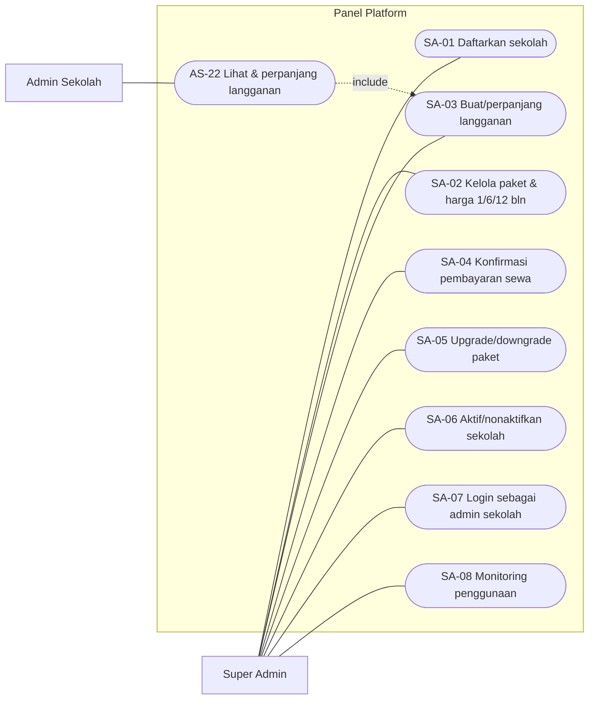

### 5.2 Pengelola sekolah (Admin Sekolah & Kepala Sekolah)

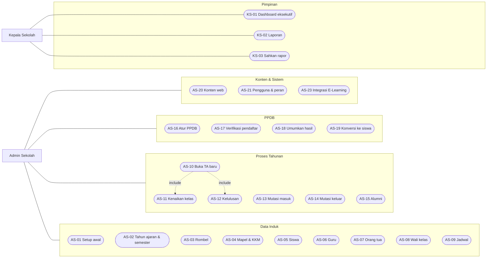

### 5.3 Guru, Wali Kelas & Bendahara

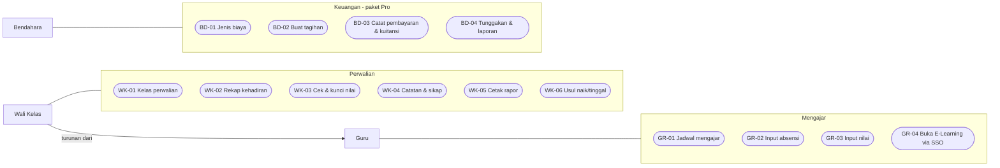

### 5.4 Siswa, Orang Tua, Calon Siswa & Pengunjung

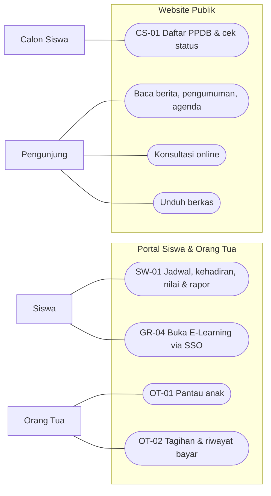

## 6. Flow proses utama

Delapan alur yang menjadi tulang punggung aplikasi. Setiap alur menyebut kode use case di bagian 4.

### 6a. Onboarding sekolah penyewa baru

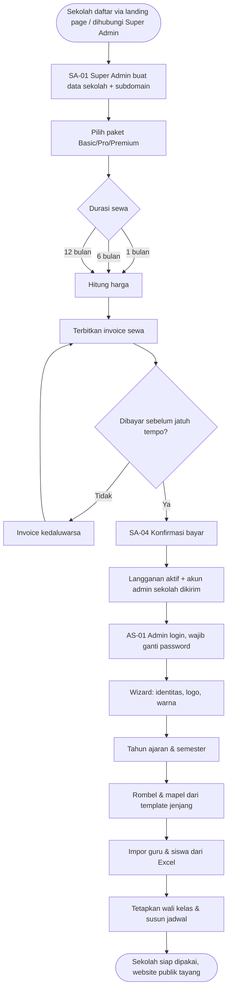

**Siklus masa aktif langganan**

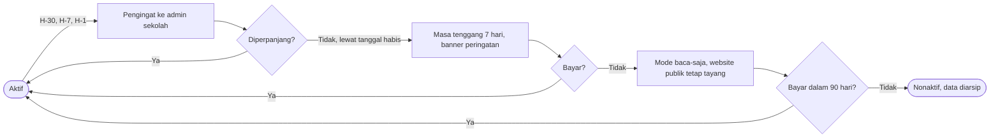

### 6b. Pergantian tahun ajaran

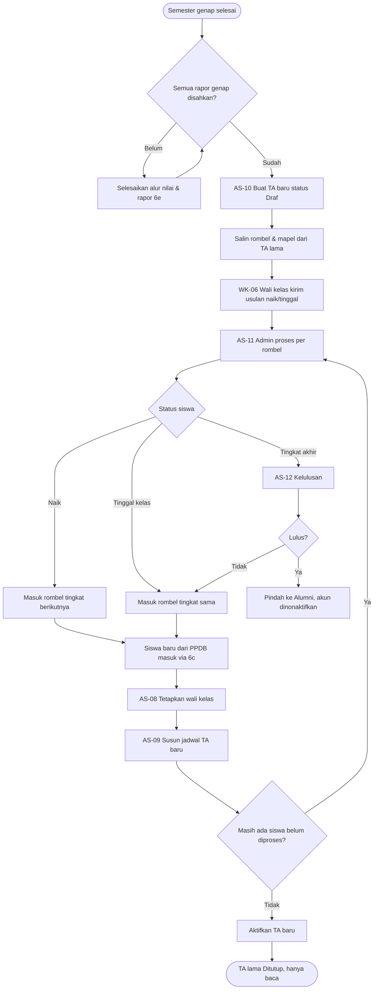

### 6c. PPDB

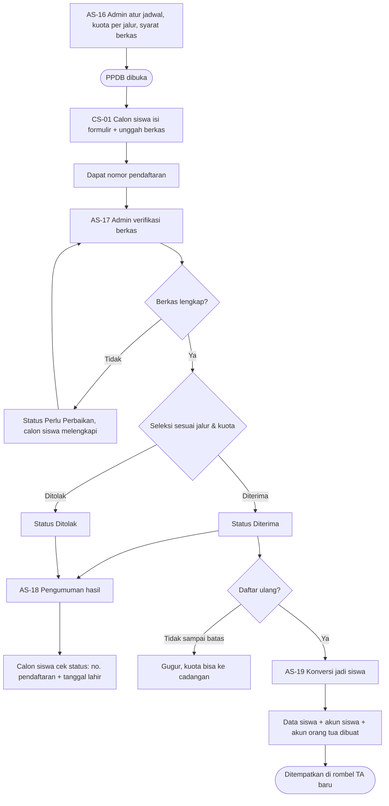

### 6d. Absensi harian

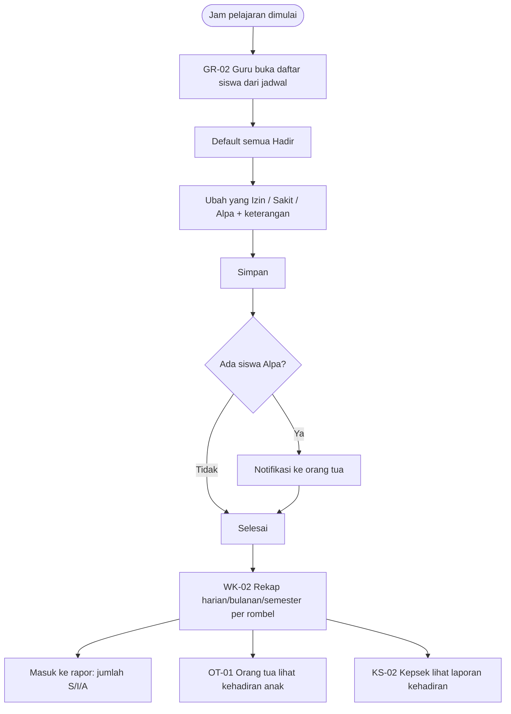

### 6e. Nilai & rapor

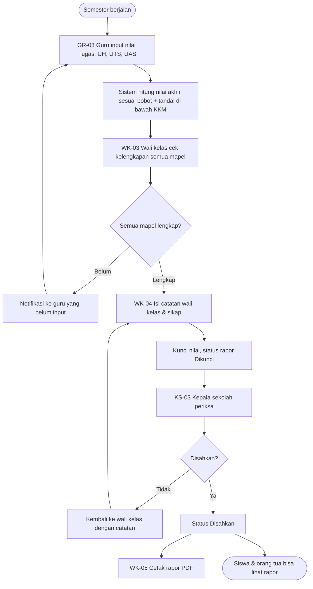

### 6f. Keuangan / SPP (paket Pro)

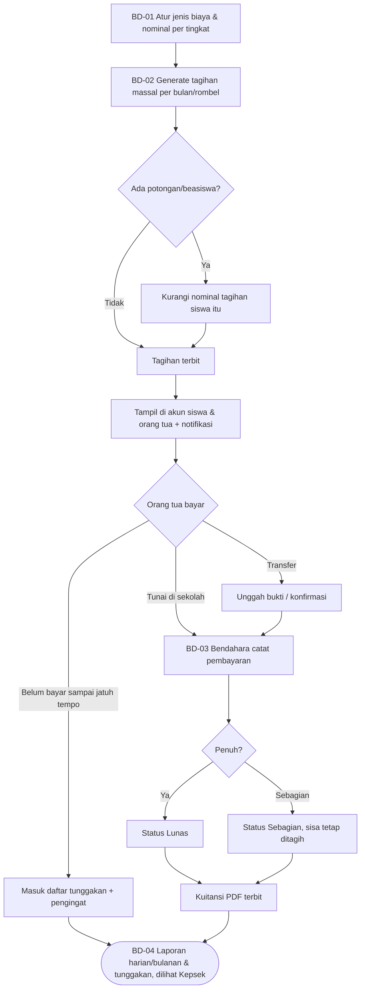

### 6g. Mutasi siswa

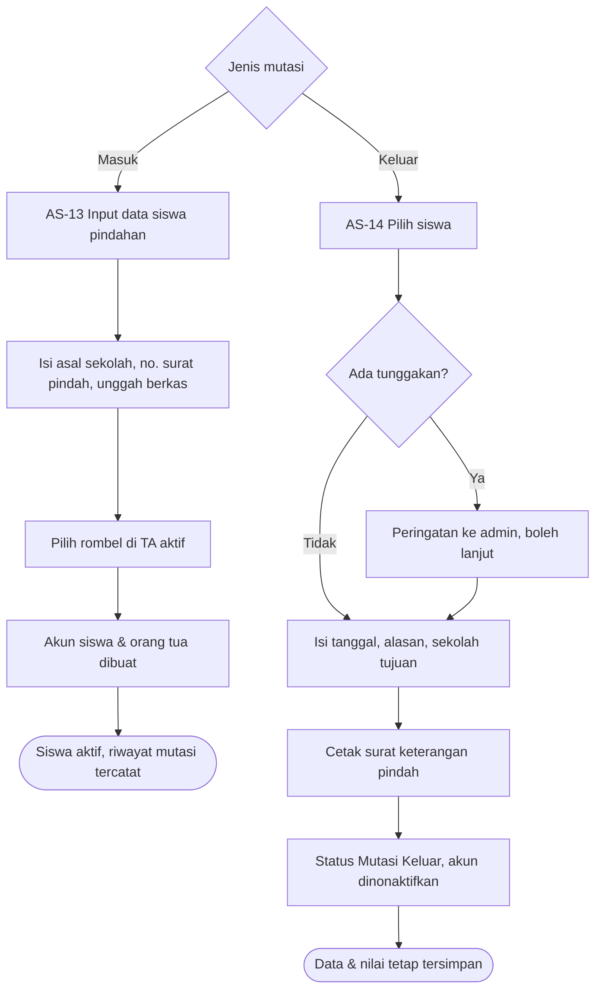

### 6h. Sinkronisasi data & SSO ke E-Learning (paket Premium)

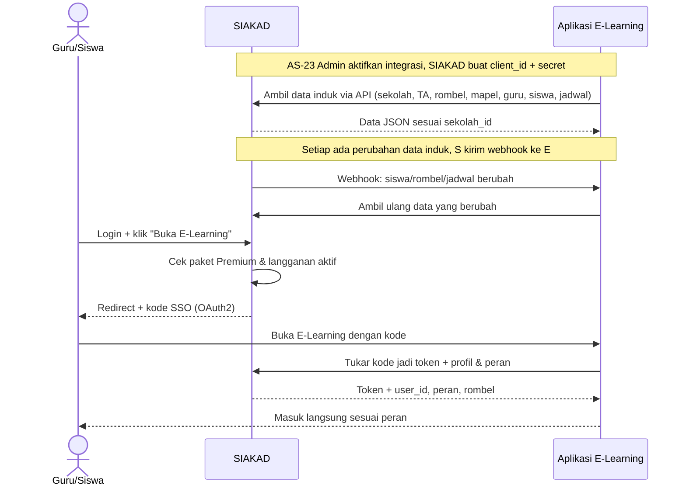

Nilai dari tugas/ujian di E-Learning bisa dikirim balik ke SIAKAD sebagai nilai jenis Tugas/UH lewat API.

## 7. Perubahan database

Perubahan terbesar: kolom `sekolah_id` di semua tabel data sekolah, dan tahun ajaran menjadi tabel sendiri yang jadi acuan rombel, jadwal, absensi, dan nilai.

### 7.1 Tabel dihapus (pindah ke E-Learning)

| Tabel | Keterangan |
| --- | --- |
| `materi` | Materi pembelajaran |
| `tugas`, `kelas_tugas` | Tugas dan relasi tugas–kelas |
| `soal_essay`, `soal_pilgan` | Bank soal |
| `tugas_siswa` | Pengerjaan tugas oleh siswa |

### 7.2 Tabel baru

| Tabel | Kolom utama | Untuk |
| --- | --- | --- |
| `sekolah` | id, nama, npsn, jenjang, subdomain, domain_kustom, status (aktif/tenggang/baca_saja/nonaktif) | Tenant |
| `paket` | id, nama, deskripsi, aktif | Basic/Pro/Premium |
| `paket_modul` | paket_id, kode_modul | Modul yang terbuka per paket |
| `paket_harga` | paket_id, durasi_bulan (1/6/12), harga, diskon_persen | Harga per durasi |
| `langganan` | sekolah_id, paket_id, durasi_bulan, mulai, berakhir, status | Masa aktif |
| `invoice_sewa` | sekolah_id, langganan_id, nomor, total, jatuh_tempo, status, dibayar_pada, bukti | Tagihan sewa |
| `tahun_ajaran` | sekolah_id, nama (2026/2027), mulai, selesai, status (draf/aktif/ditutup) | Periode |
| `semester` | tahun_ajaran_id, nama (ganjil/genap), mulai, selesai, aktif | Periode |
| `rombel` | sekolah_id, tahun_ajaran_id, tingkat, nama, wali_kelas_guru_id, kapasitas | Pengganti fungsi `kelas` per TA |
| `rombel_siswa` | rombel_id, siswa_id, status (aktif/naik/tinggal/lulus/mutasi) | Riwayat kelas siswa |
| `orang_tua` | sekolah_id, user_id, nama, hubungan, no_hp, pekerjaan | Data wali |
| `orang_tua_siswa` | orang_tua_id, siswa_id | Satu ortu bisa beberapa anak |
| `mutasi` | sekolah_id, siswa_id, jenis (masuk/keluar), tanggal, asal/tujuan, nomor_surat, alasan, berkas | Mutasi |
| `kelulusan` | siswa_id, tahun_ajaran_id, status, nomor_ijazah | Kelulusan & alumni |
| `bobot_penilaian` | sekolah_id, semester_id, jenis, bobot | Bobot bisa diatur |
| `rapor` | siswa_id, semester_id, catatan_wali, sikap, status (draf/dikunci/disahkan), disahkan_oleh | Status rapor |
| `jenis_biaya` | sekolah_id, nama, periode (bulanan/sekali), nominal_default | Keuangan |
| `tagihan` | sekolah_id, siswa_id, jenis_biaya_id, bulan, nominal, potongan, status | Keuangan |
| `pembayaran` | tagihan_id, tanggal, jumlah, metode, nomor_kuitansi, dicatat_oleh, dibatalkan | Keuangan |
| `ppdb_berkas` | pendaftar_id, jenis, file | Unggah berkas PPDB |
| `notifikasi` | sekolah_id, user_id, judul, isi, dibaca | Pengingat & info |
| `log_aktivitas` | sekolah_id, user_id, aksi, data, ip | Jejak audit |
| `sso_klien` | sekolah_id, client_id, secret, redirect_url | Integrasi E-Learning |

### 7.3 Kolom baru di tabel lama

| Tabel | Perubahan |
| --- | --- |
| Semua tabel data sekolah (`users`, `siswa`, `guru`, `mapels`, `kelas`, `jadwal`, `absensi`, `nilai`, `berita`, `kategori`, `agenda`, `pengumuman`, `gallery`, `unduhan`, `ppdb_pendaftar`, tabel chat, tabel pengaturan/situs, `testimoni`, `program_unggulan`) | + `sekolah_id` (index), unik dibuat per sekolah (misal NISN unik per sekolah, username unik per sekolah) |
| `users` | `role` diganti tabel peran (satu user bisa banyak peran): super_admin, admin, kepsek, guru, wali_kelas, bendahara, siswa, orang_tua |
| `siswa` | + nis, status (aktif/lulus/mutasi_keluar/keluar), tanggal_masuk, asal_sekolah |
| `mapels` | + kkm, kelompok, urutan |
| `jadwal`, `absensi`, `nilai` | + `semester_id`; `kelas_id` diganti `rombel_id` |
| `ppdb_pendaftar` | + tahun_ajaran_id, status_daftar_ulang, siswa_id (hasil konversi) |
| Pengaturan situs | Isian tahun ajaran, semester, KKM dihapus (pindah ke tabel di atas) |

Untuk Laravel, `sekolah_id` diisi otomatis lewat global scope + trait di setiap model, supaya data antar sekolah tidak pernah tercampur.

## 8. Prioritas pengerjaan

### Tahap 1 — Siap sewa (paket Basic)

- [ ] Hapus modul e-learning (Materi, Tugas, Soal, Tugas Siswa) beserta menu dan route-nya
- [ ] Multi-tenant: tabel `sekolah`, `sekolah_id` + global scope di semua model, deteksi subdomain
- [ ] Panel Super Admin: sekolah penyewa, paket, harga 1/6/12 bulan, langganan, invoice sewa, konfirmasi bayar manual
- [ ] Middleware langganan: masa tenggang, mode baca-saja, kunci modul per paket
- [ ] Pengingat masa aktif H-30, H-7, H-1 (email/notifikasi)
- [ ] Tahun Ajaran & Semester sebagai tabel; jadwal, absensi, nilai terikat semester
- [ ] Rombel per tahun ajaran + Wali Kelas
- [ ] Role baru: Kepala Sekolah, Wali Kelas, Orang Tua; portal Orang Tua (kehadiran, nilai, rapor)
- [ ] Wizard setup awal + impor Excel siswa & guru

### Tahap 2 — Proses tahunan & paket Pro

- [ ] Kenaikan kelas, tinggal kelas, kelulusan, alumni
- [ ] Mutasi masuk/keluar + surat keterangan pindah
- [ ] Alur rapor: kunci wali kelas → pengesahan kepsek → cetak PDF
- [ ] PPDB: unggah berkas, pengumuman hasil, daftar ulang, konversi ke siswa
- [ ] Keuangan/SPP: jenis biaya, generate tagihan, pembayaran, kuitansi, tunggakan, laporan
- [ ] Laporan & dashboard Kepala Sekolah
- [ ] Konsultasi Online dikunci ke paket Pro

### Tahap 3 — Premium & operasional

- [ ] API data induk + SSO untuk aplikasi E-Learning
- [ ] Halaman daftar sekolah baru (landing page produk) + pembayaran sewa otomatis lewat payment gateway
- [ ] Pembayaran SPP online oleh orang tua (payment gateway)
- [ ] Notifikasi WhatsApp (absen, tagihan, rapor terbit)
- [ ] Domain kustom per sekolah, monitoring penggunaan, log aktivitas lengkap, backup per sekolah
